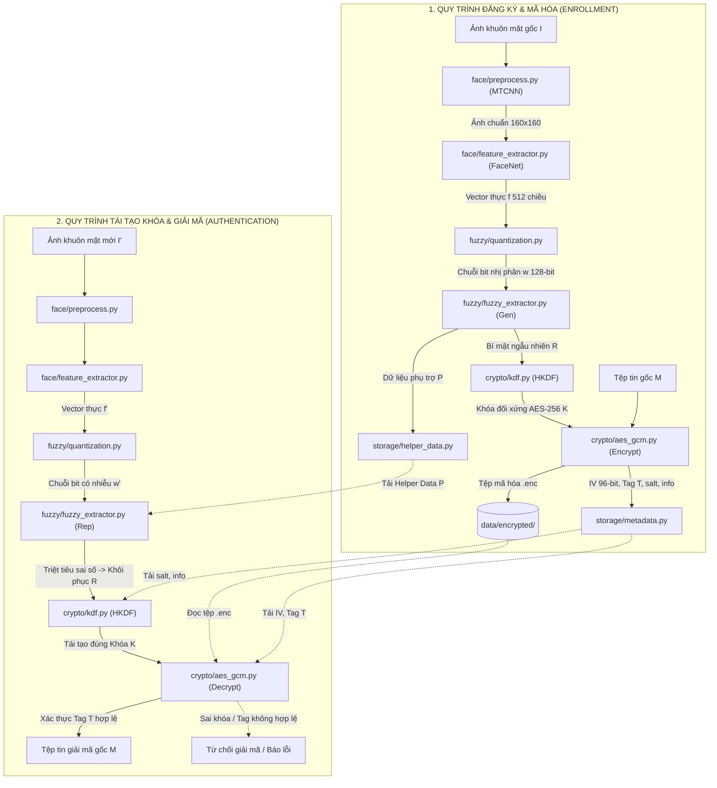

# Fuzzy Extractor & AI - Biometric Cryptographic Key Generator

> **Học viện Công nghệ Bưu chính Viễn thông (PTIT) - Khoa An toàn Thông tin**  
> **Báo cáo học phần:** Mật mã học cơ sở (Mã HP: `INT1344`)  
> **Đề tài:** Sinh khóa mật mã từ sinh trắc học kết hợp Trí tuệ nhân tạo (AI) và Fuzzy Extractor  
> **Chuẩn thiết kế kiến trúc:** Căn cứ theo báo cáo kỹ thuật `demo.pdf` (Chương 3)

---

## 📖 1. TỔNG QUAN DỰ ÁN

### 1.1. Bối cảnh & Thách thức cốt lõi
Trong các hệ thống an ninh hiện đại, việc quản lý và bảo vệ khóa mật mã truyền thống thường đối mặt với nguy cơ rò rỉ (lộ mật khẩu, khóa bị lưu cứng - *hardcoded keys*, hoặc người dùng quên mật mã). Sử dụng đặc trưng sinh trắc học (khuôn mặt, vân tay) làm nguồn sinh khóa mang lại trải nghiệm thuận tiện và an toàn.

Tuy nhiên, tồn tại một **mâu thuẫn lớn giữa Sinh trắc học và Mật mã học**:
* **Tính chất của Mật mã học:** Các thuật toán mã hóa khối đối xứng như **AES-256** đòi hỏi khóa bí mật phải **chính xác tuyệt đối 100% từng bit** (sai lệch đúng 1 bit duy nhất cũng làm thất bại hoàn toàn quá trình giải mã).
* **Tính chất của Sinh trắc học:** Dữ liệu sinh trắc của con người luôn có **độ nhiễu tự nhiên** giữa các lần thu thập (do thay đổi góc chụp, cường độ ánh sáng, biểu cảm, chất lượng cảm biến camera). Không bao giờ có hai bức ảnh chụp ra cùng một tập hợp pixel hoàn toàn giống nhau.

### 1.2. Giải pháp đề xuất
Dự án giải quyết triệt để mâu thuẫn trên bằng cách kết hợp:
1. **Mô hình Trí tuệ Nhân tạo (FaceNet - InceptionResnetV1):** Trích xuất vector đặc trưng embedding 512 chiều từ ảnh khuôn mặt chuẩn hóa, tối ưu khoảng cách Euclidean (cùng người vector rất gần, khác người vector rất xa).
2. **Kỹ thuật Lượng tử hóa (Quantization):** Ánh xạ vector số thực liên tục thành chuỗi bit nhị phân rời rạc $w \in \{0, 1\}^{128}$.
3. **Mật mã Sinh trắc học (Fuzzy Extractor):** Áp dụng cấu trúc *Secure Sketch* và mã sửa lỗi khối nhị phân **BCH (Bose–Chaudhuri–Hocquenghem)** để triệt tiêu sai số bit tự nhiên, tái tạo chính xác duy nhất một chuỗi bí mật $R$ từ cùng một đối tượng.
4. **Dẫn xuất khóa chuẩn (HKDF-HMAC-SHA256):** Chuyển đổi bí mật $R$ thành khóa chuẩn **AES-256 (32 bytes)**.
5. **Mã hóa có xác thực (AES-256-GCM):** Bảo vệ tính bí mật và kiểm tra tính toàn vẹn dữ liệu tệp tin thông qua giá trị khởi tạo $IV$ (96-bit) và thẻ xác thực Tag $T$ (128-bit).

---

## 🛠️ 2. CÔNG NGHỆ VÀ CÔNG CỤ SỬ DỤNG

| Nhóm công nghệ | Công cụ / Thư viện | Phiên bản | Vai trò & Mục đích sử dụng |
| :--- | :--- | :--- | :--- |
| **Ngôn ngữ nền tảng** | **Python** | `3.10+` | Ngôn ngữ phát triển toàn bộ hệ thống, tích hợp ML và Mật mã học. |
| **Học sâu (Deep Learning)** | **PyTorch** (`torch`, `torchvision`) | `>= 2.0.0` | Khung làm việc tính toán tensor và nạp mô hình mạng nơ-ron sâu. |
| **Tiền xử lý khuôn mặt** | **MTCNN** (`facenet-pytorch`) | `>= 2.5.3` | Tự động phát hiện vùng mặt, căn chỉnh 5 mốc hình học (mắt, mũi, khóe miệng) và cắt chuẩn hóa về $160 \times 160$. |
| **Trích xuất đặc trưng AI** | **InceptionResnetV1** (`facenet-pytorch`) | Pre-trained `vggface2` | Ánh xạ ảnh khuôn mặt thành vector embedding 512 chiều đã được chuẩn hóa $L_2$. |
| **Thị giác máy tính** | **OpenCV** (`opencv-python`) & **Pillow** | `Pillow >= 9.5` | Đọc, xử lý ma trận điểm ảnh, lọc nhiễu ảnh vân tay (CLAHE, Gaussian). |
| **Xử lý số liệu** | **NumPy** | `>= 1.24.0` | Thao tác ma trận, lượng tử hóa vector và tính khoảng cách Hamming. |
| **Mã sửa lỗi** | **BCHlib** | `>= 0.14.0` | Cài đặt mã sửa sai BCH nhị phân $(n, k, d)$ với khả năng chịu lỗi $t = 10$ bits. |
| **Mật mã học chuẩn** | **Cryptography** | `>= 41.0.0` | Cài đặt chuẩn công nghiệp cho **HKDF-HMAC-SHA256** và **AES-256-GCM**. |

---

## 🏛️ 3. KIẾN TRÚC HỆ THỐNG VÀ LUỒNG DỮ LIỆU

Kiến trúc phần mềm được thiết kế theo hướng **phân tách module độc lập**, phân định nghiêm ngặt giữa tầng Sinh trắc học và tầng Mật mã học:

### 3.1. Sơ đồ luồng toàn trình



### 3.2. Nguyên tắc An toàn cốt lõi (Security Guarantees)
1. **Zero-Knowledge Key Storage:** Hệ thống tuyệt đối **không lưu trữ khóa AES hay bí mật $R$ dưới dạng bản rõ** trên ổ đĩa. Khóa chỉ được sinh tức thời trong bộ nhớ RAM khi thao tác và bị thu hồi ngay sau khi xong phiên.
2. **Helper Data Protection:** Helper Data $P$ được công khai lưu trữ nhưng không làm lộ dữ liệu sinh trắc học gốc nhờ tính chất một chiều của hàm trích xuất và cơ chế XOR với từ mã bảo vệ.
3. **Chống tấn công Replay & Tampering:** Mỗi phiên mã hóa tạo một giá trị $IV$ 96-bit ngẫu nhiên duy nhất. Thuật toán AES-GCM tự động phát hiện và ngăn chặn mọi hành vi sửa đổi file mã hóa thông qua thẻ xác thực Tag 128-bit.

---

## 📂 4. CẤU TRÚC THƯ MỤC DỰ ÁN (MỤC 3.6.2 DEMO.PDF)

Cấu trúc mã nguồn phản ánh chính xác thiết kế tại **Hình 3.6.2 - Trang 57 trong báo cáo `demo.pdf`**:

```text
Fuzzy_Extractor_AI/
├── main.py                     # Điều phối toàn bộ chương trình (giao diện CLI: enroll, decrypt, test)
├── config.py                   # Cấu hình các hằng số hệ thống (ngưỡng t, số bit, đường dẫn)
├── requirements.txt            # Danh sách các thư viện phụ thuộc
├── README.md                   # Tài liệu tóm tắt dự án, hướng dẫn cài đặt và sử dụng
│
├── face/                       # Nhánh xử lý sinh trắc học khuôn mặt
│   ├── preprocess.py           # Tiền xử lý: Phát hiện mặt, căn chỉnh mốc và chuẩn hóa ảnh (MTCNN)
│   └── feature_extractor.py    # Trích xuất vector embedding 512 chiều bằng FaceNet (InceptionResnetV1)
│
├── fingerprint/                # Nhánh xử lý sinh trắc học vân tay (xử lý độc lập)
│   ├── preprocess.py           # Giảm nhiễu, tăng cường tương phản đường vân (CLAHE, Gaussian)
│   └── feature_extractor.py    # Trích xuất biểu diễn đặc trưng vân tay
│
├── fuzzy/                      # Khối lượng tử hóa và thuật toán Fuzzy Extractor
│   ├── quantization.py         # Lượng tử hóa vector float 512 chiều thành chuỗi nhị phân 128-bit
│   ├── ecc.py                  # Cơ chế mã sửa lỗi BCH nhị phân (khả năng sửa tối đa t=10 bits)
│   └── fuzzy_extractor.py      # Thuật toán cốt lõi: Gen(w) -> (R, P) và Rep(w', P) -> R
│
├── crypto/                     # Khối các phép toán mật mã học chuyên biệt
│   ├── kdf.py                  # Dẫn xuất khóa HKDF-HMAC-SHA256 (tạo khóa AES-256 từ bí mật R)
│   └── aes_gcm.py              # Mã hóa và giải mã file bằng AES-256-GCM (tạo IV, xác thực Tag)
│
├── storage/                    # Khối quản lý lưu trữ dữ liệu lâu dài
│   ├── helper_data.py          # Lưu trữ và truy xuất Helper Data P (.json)
│   └── metadata.py             # Quản lý siêu dữ liệu: IV, Tag, salt, info, profile_id
│
├── data/                       # Dữ liệu ảnh và tệp tin kiểm thử
│   ├── face/                   # Ảnh khuôn mặt thử nghiệm (theo profile cá nhân)
│   ├── fingerprint/            # Ảnh vân tay thử nghiệm
│   └── encrypted/              # Thư mục chứa các tệp sau khi mã hóa (.enc)
│
└── tests/                      # Bộ kịch bản kiểm thử độc lập (Unit Test) cho từng module
    ├── test_face.py            # Kiểm thử tiền xử lý và trích xuất khuôn mặt FaceNet
    ├── test_fingerprint.py     # Kiểm thử tiền xử lý và trích xuất vân tay
    ├── test_fuzzy.py           # Kiểm thử lượng tử hóa, mã sửa lỗi BCH và hàm Gen/Rep
    └── test_crypto.py          # Kiểm thử tính đúng đắn của HKDF và tính toàn vẹn AES-GCM
```

---

## 🧩 5. ĐẶC TẢ CHI TIẾT CÁC MODULE

### 5.1. Nhánh Khuôn mặt (`face/`)
* **`preprocess.py`:**
  * Nhận ảnh đầu vào bất kỳ, gọi mô hình **MTCNN** để nhận diện khuôn mặt.
  * Tự động căn góc nghiêng, cắt bỏ phần nền dư thừa và chuẩn hóa kích thước về chuẩn $160 \times 160 \times 3$.
* **`feature_extractor.py`:**
  * Nạp mạng nơ-ron **InceptionResnetV1** với trọng số pre-trained `vggface2`.
  * Xuất ra vector đặc trưng $\mathbf{f} \in \mathbb{R}^{512}$ được chuẩn hóa $L_2$ ($\|\mathbf{f}\|_2 = 1$).

### 5.2. Nhánh Vân tay (`fingerprint/`)
* **`preprocess.py`:** Áp dụng thuật toán cân bằng biểu đồ cục bộ thích ứng (**CLAHE**) và lọc nhiễu Gaussian để tăng độ tương phản giữa đỉnh vân (*ridge*) và rãnh vân (*valley*).
* **`feature_extractor.py`:** Trích xuất vector đặc trưng cấu trúc đường vân để đưa vào lượng tử hóa.

### 5.3. Khối Fuzzy Extractor (`fuzzy/`)
* **`quantization.py`:** Chuyển đổi vector số thực liên tục sang chuỗi nhị phân $w \in \{0, 1\}^{128}$ bằng phương pháp phân cực theo ngưỡng $0$:
  $$b_i = \begin{cases} 1 & \text{nếu } f_i \ge 0 \\ 0 & \text{nếu } f_i < 0 \end{cases}$$
* **`ecc.py`:** Khởi tạo mã khối **BCH** với đa thức nguyên thủy $8219$, thiết lập tham số khả năng sửa lỗi $t = 10\text{ bits}$.
* **`fuzzy_extractor.py`:**
  * **Hàm `Gen(w)`:** Sinh chuỗi bí mật $R$, tính từ mã $C = \text{BCH.Encode}(R)$, tính Helper Data $P = w \oplus C$.
  * **Hàm `Rep(w', P)`:** Tính từ mã có lỗi $C' = P \oplus w'$, gọi $\text{BCH.Decode}(C')$ để triệt tiêu sai số bit và khôi phục chính xác $R$.

### 5.4. Khối Mật mã (`crypto/`)
* **`kdf.py`:** Triển khai **HKDF (RFC 5869)** sử dụng hàm băm ngầm định SHA-256, nhận đầu vào là bí mật $R$ cùng $salt$ và chuỗi ngữ cảnh $info$, sinh đúng $32\text{ bytes}$ ($256\text{ bits}$) cho khóa AES.
* **`aes_gcm.py`:** Cung cấp 2 phương thức:
  * `encrypt_file(filepath, key)`: Sinh ngẫu nhiên $IV$ 96-bit, mã hóa dữ liệu và xuất thẻ xác thực Tag 128-bit.
  * `decrypt_file(filepath, key, iv, tag)`: Giải mã và xác thực thẻ Tag; từ chối giải mã ngay lập tức nếu dữ liệu hoặc khóa bị sai lệch.

### 5.5. Khối Lưu trữ (`storage/`)
* **`helper_data.py`:** Lưu trữ Helper Data $P$ dưới định dạng JSON theo từng hồ sơ `profile_id`.
* **`metadata.py`:** Lưu trữ các thông số phiên ($IV$, Tag, $salt$, $info$) phục vụ xác thực và giải mã.

---

## ⚡ 6. HƯỚNG DẪN CÀI ĐẶT & CHẠY THỬ NGHIỆM

### 6.1. Cài đặt môi trường
Khuyến nghị sử dụng Python 3.10+ và môi trường ảo `venv`:

```bash
# Di chuyển vào thư mục dự án
cd c:\Projects\Mật mã học cơ sở btcn\Fuzzy_Extractor_AI

# Khởi tạo môi trường ảo
python -m venv venv

# Kích hoạt môi trường ảo (Windows PowerShell)
.\venv\Scripts\Activate.ps1

# Cài đặt toàn bộ các thư viện cần thiết
pip install torch torchvision facenet-pytorch opencv-python Pillow numpy bchlib cryptography
```

### 6.2. Hướng dẫn sử dụng CLI (`main.py`)

#### Bước 1: Đăng ký sinh trắc học và mã hóa tài liệu
```bash
python main.py --mode enroll --profile user01 --image data/face/user01_enroll.jpg --input-file data/secret_doc.pdf
```
*Chương trình sẽ tự động: Trích xuất đặc trưng $\to$ Lượng tử hóa $\to$ Sinh bí mật $R$ & Helper Data $P$ $\to$ Dẫn xuất khóa AES-256 $\to$ Mã hóa `secret_doc.pdf` thành `data/encrypted/user01_encrypted.enc`.*

#### Bước 2: Tái tạo khóa bằng ảnh quét mới và giải mã tài liệu
```bash
python main.py --mode decrypt --profile user01 --image data/face/user01_verify.jpg --output-file data/recovered_doc.pdf
```
*Chương trình sẽ: Quét ảnh mới $\to$ Tải Helper Data $P$ $\to$ Giải mã sửa sai BCH để tái tạo $R$ $\to$ Tái tạo khóa AES-256 $\to$ Giải mã và xác thực thẻ Tag GCM $\to$ Khôi phục file gốc.*

### 6.3. Chạy kiểm thử tự động (Unit Tests)
```bash
# Kiểm tra nhánh khuôn mặt
python -m unittest tests/test_face.py

# Kiểm tra thuật toán Fuzzy Extractor & Sửa lỗi BCH
python -m unittest tests/test_fuzzy.py

# Kiểm tra tính toàn vẹn của mã hóa AES-GCM
python -m unittest tests/test_crypto.py
```

---

## 📊 7. KẾT QUẢ ĐÁNH GIÁ THỰC NGHIỆM DỰ KIẾN (CHƯƠNG 4 DEMO.PDF)

Theo thiết kế thực nghiệm trong báo cáo:
1. **Khoảng cách Hamming:**
   * Cùng một người (khác điều kiện chụp): Khoảng cách Hamming dao động từ **$2 - 8\text{ bits}$ / $128\text{ bits}$** (nằm hoàn toàn trong khả năng sửa lỗi $t = 10\text{ bits}$ của BCH).
   * Khác người: Khoảng cách Hamming trung bình $\approx 64\text{ bits}$ ($\approx 50\%$), BCH hoàn toàn không thể giải mã nhầm.
2. **Chỉ số bảo mật:**
   * **FRR (False Reject Rate):** Mục tiêu $< 5\%$.
   * **FAR (False Accept Rate):** Mục tiêu **$0.0\%$** (Người lạ tuyệt đối không thể mở được khóa).
3. **Thời gian thực thi:** Toàn bộ chu trình từ đọc ảnh đến ra khóa AES mất **$< 0.2\text{ giây}$** trên CPU thông thường.

---

## 📜 8. TÀI LIỆU THAM KHẢO CHÍNH
* **[1]** Schroff, F., Kalenichenko, D., & Philbin, J. (2015). *FaceNet: A Unified Embedding for Face Recognition and Clustering*. IEEE CVPR.
* **[2]** Dodis, Y., Ostrovsky, R., Reyzin, L., & Smith, A. (2008). *Fuzzy Extractors: How to Generate Strong Keys from Biometrics and Other Noisy Data*. SIAM Journal on Computing.
* **[3]** NIST FIPS PUB 197: *Advanced Encryption Standard (AES)*.
* **[4]** NIST Special Publication 800-38D: *Recommendation for Block Cipher Modes of Operation: Galois/Counter Mode (GCM)*.
* **[5]** RFC 5869: *HMAC-based Extract-and-Expand Key Derivation Function (HKDF)*.